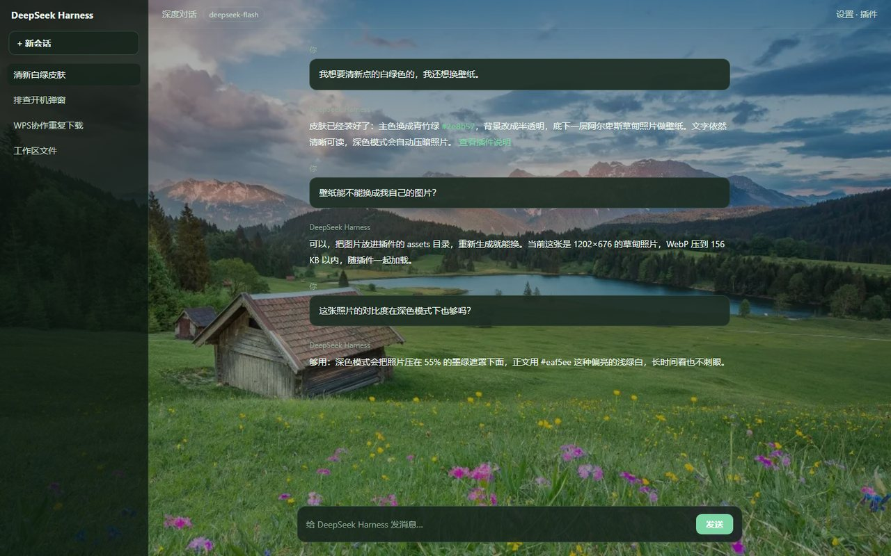

# 清新白绿皮肤（Fresh Green Skin）

给 DSH Web 界面加一层“白绿清新”外观：青竹绿品牌色、半透明的面板，背后铺一张照片壁纸（默认是阿尔卑斯草甸），并在 **设置 → 通用 → 壁纸** 里提供**上传自己的图片**和**透明度滑块**。


## 特性

- 浅色 / 深色 / 跟随系统 三档照常可用，两套配色同时覆盖。
- 壁纸默认随插件加载（WebP 内联，约 152 KB），不联网、不依赖外部图床。
- **透明度 0% = 壁纸完全显示，100% = 壁纸完全遮住**，拖动即时生效。
- **上传图片**：任意 JPG/PNG/WebP，自动缩到最长边 1920 并转成 JPEG 存储，避免体积过大。
- 偏好存在浏览器 `localStorage`，不写 Host 配置，也不跨设备同步。

| 设置项 | 深色模式 |
| --- | --- |
|  |  |

## 安装

需要支持 client 插件（`dsh.client`）的 DSH Web 版本。

### 方式一：从 GitHub 安装（推荐）

打开侧栏 **插件 → 添加插件**，把仓库地址填进输入框：

```
https://github.com/Kiki-trouvaille/dsh-fresh-green-skin
```

安装完成后点 **立即启用**（或到插件列表里打开），然后 `Ctrl+R` 刷新页面。

### 方式二：本地目录

1. 下载本仓库（Code → Download ZIP 后解压，或 git clone https://github.com/Kiki-trouvaille/dsh-fresh-green-skin.git）。
2. **插件 → 添加插件 → 本地目录**，选择解压出来的文件夹（含 `package.json` 的那一层）。
3. 启用后 `Ctrl+R`。

### 方式三：压缩包

把仓库打成的 `.zip` 直接拖进 **添加插件**（或填绝对路径），效果同方式二。

## 使用

- **换壁纸**：设置 → 通用 → 壁纸 → **上传图片**。
- **调透明度**：同一行的滑块；0% 看整张照片，100% 只剩配色。
- **回到默认壁纸**：**恢复默认**。
- 卸载：插件列表里移除 `dsh-fresh-green-skin`，配色、壁纸、设置项一起消失。

## 改默认壁纸 / 二次开发

`client.js` 是由模板生成的，改逻辑请改 `client.js.tpl`，再跑生成脚本（需要 Python 3 + Pillow）：

```bash
python tools/build-client.py
```

脚本会：读 `assets/wallpaper-src.png` → 压成 q78 WebP（`assets/wallpaper.webp`）→ 把 base64 填进模板的 `__WALL_B64__` → 写出 `client.js`。

替换默认壁纸只要覆盖 `assets/wallpaper-src.png` 再跑一次脚本，然后 `Ctrl+R`；本机存过自定义壁纸的话，先在设置里点“恢复默认”。

## 兼容性

- 只作用于 Web 端（`dsh.client.platform: 'web'`）。
- 通过 `theme.overrideTokens()` 覆盖 token，未识别的 token 名会被忽略，不会报错；DSH 改版后若某些颜色不再生效，对照 `client.js.tpl` 的 `TOKENS` 补名字即可。
- 深色模式下正文是浅色字，透明度拉得很低（照片很亮）时对比度会下降，建议深色模式保留 40% 以上。

## 许可

MIT
