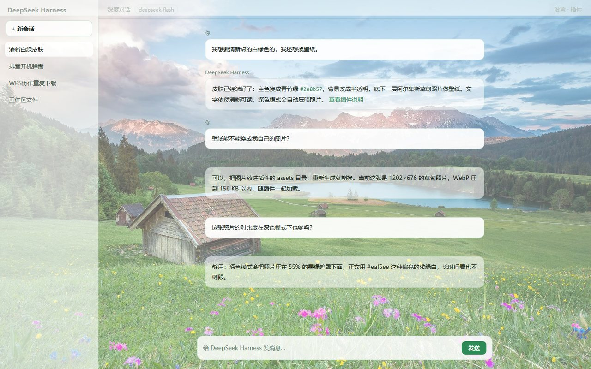
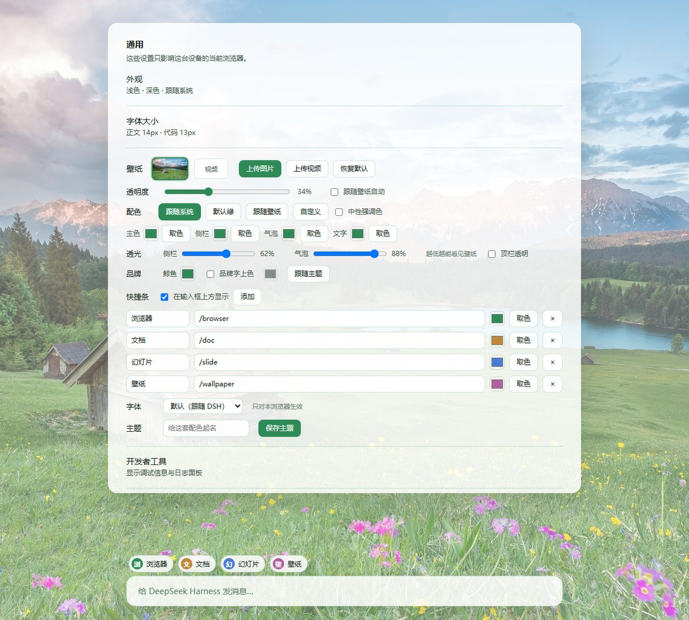

# 清新白绿皮肤（Fresh Green Skin）



给 DSH Web 界面加一层“白绿清新”外观：青竹绿品牌色、半透明的面板，背后铺一张 4K 照片壁纸（默认「山舍晴暮」）。壁纸可以是内置照片、你自己的图片，甚至一段循环视频；配色可以跟着壁纸走，也可以自己挑；满意的组合能存成命名主题，用快捷键随时切回来。


## 特性

- 浅色 / 深色 / 跟随系统 三档照常可用，两套配色同时覆盖。
- **壁纸**：内置 4K 照片随插件加载（AVIF 内联，约 713 KB，不联网、不依赖图床）；也可以**上传图片**（自动缩到最长边 1920 存成 JPEG）或**上传视频**（循环播放的动态壁纸，存进 IndexedDB）。
- **透明度 0% = 壁纸完全显示，100% = 壁纸完全遮住**；勾上「跟随壁纸自动」则由照片亮度自动定一个既透又看得清的浓度。Windows 下应用外框会让位给壁纸，顶栏与侧栏共用同一层磨砂，不会出现两块颜色割裂。
- **一键预设**：壁纸下面四张卡片——清爽白绿 / 全壁纸 / 跟随系统 / 纯纸面——点一下就把配色、透明度、透光一次调好，再往下微调；懒得调就到此为止。
- **配色五种来源**：跟随系统（五套系统纸色：中性灰 / 冷白 / 暖白 / 雾灰 / 墨黑，想彻底贴近宿主原样还可以勾「中性强调色」把绿色换成中性灰）/ 默认绿 / 跟随壁纸（从画面平均色推出主色、气泡、文字）/ 自定义 / 纯纸面。**改色先定一个「纸面」锚点**：定了纸色，面板、描边、次级文字都由它推出，和「先挑角色色、再微调」的思路一致；需要时再单独改主色、侧栏、气泡、文字，每个都能「取色」——点壁纸任意一点取那里的颜色。发送按钮、链接、滑块等强调色都跟着主色走。
- **任何壁纸都看得清**：勾上「自动保证对比」后，遮罩浓度按照片（或视频首帧）的亮度反推——照片亮就多压一点、暗就少压一点，文字色再按"照片 + 遮罩"的实际底色选深字或浅字，所以换成纯白雪山、夜景或深色视频都不用自己试。想手动接管就取消勾选，滑块交回给你。
- **透光**：侧栏、气泡各有独立的不透明度滑块，选了自己喜欢的颜色也不会把壁纸整块糊掉；默认 62% / 88%。侧栏还能整套关掉（「侧栏填充」不勾 = 完全不铺色，壁纸直接透上来），顶栏默认与侧栏共用同一层磨砂，勾「顶栏透明」就让照片一直铺到最上面。
- **回复气泡**：助手的回复会像你的消息一样落在一个圆角气泡里（同色系、带描边），不再直接压在照片上；**回复** 一行的滑块控制这层气泡的不透明度，默认 55%，拉到 0 就只剩描边。
- **品牌色**：新会话页的大鲸鱼、侧栏 `deepseek HARNESS` 字样各有一个取色器，挑了就生效（不用再勾开关）；「跟随主题」一次还原两者。`HARNESS` 徽标是同一块 SVG 里的反转色字母，插件会自动按你选的字色翻成深或浅，徽标不会糊掉。
- **快捷条**：在输入框上方放一排首字母图标（颜色自选或从壁纸取色），点一下就把预设文字插进输入框；「插件 → 设置 → 通用 → 快捷条」里增删。
- **字体**：默认 / 黑体 / 宋体 / 楷体 / 衬线英文 / 等宽，只改本浏览器。
- **命名主题**：把壁纸 + 透明度 + 配色 + 透光 + 快捷条 + 字体存成一套，起个名字留在设置行里；`Ctrl+Alt+1…9` 直接切换，`Ctrl+Alt+0` 回默认。
- **导入导出**：主题一行多了 **导出 / 导入**，把当前配色连同已存主题写成 `fresh-green-theme.json`，别人导入即可复刻。
- **自定义图标**：**图标** 一行可以上传 PNG/SVG 替换侧栏与新会话的品牌标识，也可以勾「隐藏大鲸鱼」只留纯色背景。
- 偏好存在浏览器 `localStorage`（视频在 IndexedDB），不写 Host 配置，也不跨设备同步。

| 设置项（壁纸 / 配色 / 字体 / 主题） | 深色模式 |
| --- | --- |
|  |  |

## 安装

需要支持 client 插件（`dsh.client`）的 DSH Web 版本。

### 方式一：从 GitHub 安装（推荐）

打开侧栏 **插件 → 添加插件**，把仓库地址填进输入框：
```
https://github.com/Kiki-trouvaille/dsh-fresh-green-skin
```

安装完成后点 **立即启用**（或到插件列表里打开），然后 `Ctrl+R` 刷新页面。

### 方式二：本地目录

1. 下载本仓库（Code → Download ZIP 后解压，或 git clone https://github.com/Kiki-trouvaille/dsh-fresh-green-skin.git）。
2. **插件 → 添加插件 → 本地目录**，选择解压出来的文件夹（含 `package.json` 的那一层）。
3. 启用后 `Ctrl+R`。

### 方式三：压缩包

把仓库打成的 `.zip` 直接拖进 **添加插件**（或填绝对路径），效果同方式二。

## 使用

- **换壁纸**：设置 → 通用 → 壁纸，点缩略图用内置照片，**上传图片**用自己的图，**上传视频**换成动态壁纸（点「视频」那块缩略图也能换）。
- **一键换风格**：**一键预设** 四张卡片先定整体观感，再往下微调。
- **调透明度**：同一行的滑块，0% 看整张照片、100% 只剩配色；勾「跟随壁纸自动」交给插件判断。
- **改配色**：配色一行里选「跟随系统 / 默认绿 / 跟随壁纸 / 自定义」；下面那行色块对应主色、**纸面**、侧栏、气泡、文字——**纸面**是锚点，定了它面板、描边、次级文字自动跟着走；每个色块旁的 **取色** 让你直接在壁纸上点一下取色。
- **不让颜色糊住壁纸**：**透光** 一行里调侧栏、气泡的不透明度（越低越透），不想让侧栏铺任何颜色就取消「侧栏填充」。换了深色背景或夜景照片也不用自己试浓度——「自动保证对比」会跟着画面亮度定遮罩、并按实际底色挑深字或浅字。
- **回复气泡**：**回复** 一行拖滑块改助手气泡的不透明度；0% 时只剩 1px 描边，文字直接坐在壁纸上。
- **品牌色**：**品牌** 一行里，左边色块改侧栏与大鲸鱼的鲸鱼图形，右边「品牌字」改 `deepseek HARNESS` 字样；`HARNESS` 徽标里的字母会自动翻成与字色相反的深浅，点「跟随主题」还原两者。
- **换图标**：**图标** 一行 **上传图标**（PNG/SVG，自动缩到 96px），侧栏与新会话的标识一起换成你的；勾「隐藏大鲸鱼」则大鲸鱼也不再显示。
- **快捷条**：**快捷条** 一行勾上「在输入框上方显示」，点 **添加**，填名称和点图标时要插入的文字；颜色可以直接选，也可以 **取色** 从壁纸里点。保存的图标会出现在新会话输入框上方，点一下插入文字。
- **换字体**：字体下拉框。
- **存主题**：主题一行填名字 → **保存主题**；已存的主题会作为按钮出现，点一下应用，`×` 删除，`Ctrl+Alt+序号` 切换。
- **分享 / 迁移**：主题一行 **导出** 生成 `fresh-green-theme.json`，**导入** 读回别人的文件（配色与已存主题一起带）。
- **回默认**：**恢复默认**（回到内置壁纸 + 默认配色 + 默认透明度）。
- 卸载：插件列表里移除 `dsh-fresh-green-skin`，配色、壁纸、设置项一起消失。

## 内置壁纸 / 二次开发

壁纸清单在 `assets/presets/manifest.json`：`file` 指向 `assets/presets/` 里的图片，`css` 则是一段纯 CSS 渐变；**数组第一项就是默认壁纸**。目前清单里只有一张 4K 照片：

```json
[
  { "id": "meadow", "label": "山舍晴暮", "file": "meadow.jpg" }
]
```

加一张内置壁纸：把图片放进 `assets/presets/`，在 manifest 里加一条（可以让 `file` 指向照片，也可以用 `css` 写纯渐变），重新生成 `client.js`（需要 Python 3 + Pillow）：

```bash
python tools/build-client.py
```

脚本会：读 manifest 里每张图片 → 超过 3840 宽才缩 → 压成 AVIF q60（Pillow 不带 AVIF 时回落 WebP q82）→ 以 `url("data:image/avif;base64,…")` 的形式把整份清单注入 `client.js.tpl` 的 `__PRESETS__` → 写出 `client.js`（默认那张同时另存为 `assets/wallpaper.avif`）。
4K 原图不缩、质量给足的代价是 bundle 变大：现在 `client.js` 约 1.0 MB，其中壁纸约 730 KB。

`client.js` 是生成物，改逻辑请改 `client.js.tpl`。改完跑一遍离线冒烟测试（不需要浏览器）：它会用一套假的 DSH 客户端加载 `client.js`，检查服务注入、token 覆盖、设置行注册，并把壁纸那一行**真的渲染一次**——渲染报错是这里唯一会静默失败的环节（设置里的整行会直接消失）。

```bash
node tools/smoke-test.cjs
```

`tmp/preview-settings.html` 与 `tmp/preview-photo.html`（在仓库外层的工作区里，不随包发布）用真实 `client.js` 做无头渲染，改样式后可以先生成截图再交付。

## 已知限制

- 大鲸鱼、侧栏字样、快捷条都是**尽力而为**地贴着宿主渲染的标记/插槽做：鲸鱼是 `canvas[data-home-whale]`（宿主画它时读 `color`），侧栏是 `[class*='_brandName']` / `[class*='_brandIdentity']`，快捷条走官方的 `conversation.input.dock` 插槽。DSH 换掉这些标记名时，对应的着色会失效（不会影响别处），到时对照 `client.js.tpl` 的 CSS 改选择器即可。
- 快捷条的点击依赖找到 composer 的 textarea（`[data-composer] textarea` → `textarea` → `[contenteditable]` 依次尝试）；若某个版本用了别的输入组件，图标能显示但插入会失败。
- 视频壁纸用 `position: fixed` 的负 z-index 元素铺在内容后面，个别主题若给 `html`/`body` 加了不透明背景，视频会被盖住——这时把透明度调低或先切回图片壁纸即可。
- 回复气泡靠宿主的 `data-chat-flow-kind` 标记识别“不是用户消息、也不是工具卡片”的行；如果某个版本换了这套标记，气泡不会出现（也不影响其他功能）。这时打开设置里的 **诊断容器**：每条消息会被画上红色虚线并标出它的类型，截一张图就能定位该改哪个选择器。

## 兼容性

- 只作用于 Web 端（`dsh.client.platform: 'web'`）。
- 通过 `theme.overrideTokens()` 覆盖 token，未识别的 token 名会被忽略，不会报错；DSH 改版后若某些颜色不再生效，对照 `client.js.tpl` 的 `BASE_TOKENS` 补名字即可。
- 壁纸能透到内容区的前提是 Windows 下应用外框用的是 `--dsw-specific-sidebar-fill`：本插件把它设成全透明，再用 `[class*='_sidebarCol']` 给侧栏单独补一层霜白。若某个 DSH 版本改了类名，侧栏会跟着变透明，其余不受影响。
- 深色模式下正文是浅色字；勾着「自动保证对比」时遮罩会按画面亮度自己加浓，不需要手调。若手动关掉自动对比又把照片调得很亮，文字就会发灰——这时要么提高透明度，要么把「文字」色块调深。

## 插件市场索引

仓库根目录带一份符合 DSH 索引格式（`format: 1`）的 `market-index.json`，指向本仓库某个提交。启用 GitHub Pages 后，把下面这个地址加进 DSH 的 **插件 → 发现 → 添加索引源**，就能像逛市场一样浏览并安装：

```
https://kiki-trouvaille.github.io/dsh-fresh-green-skin/market-index.json
```

索引里的 `versions[].source.commit` 是固定的 40 位提交号，发新版时要把它改成本次提交并同步 `version` / `publishTimestamp`（`publishTimestamp` 是 Unix 秒）。

## 许可

MIT
